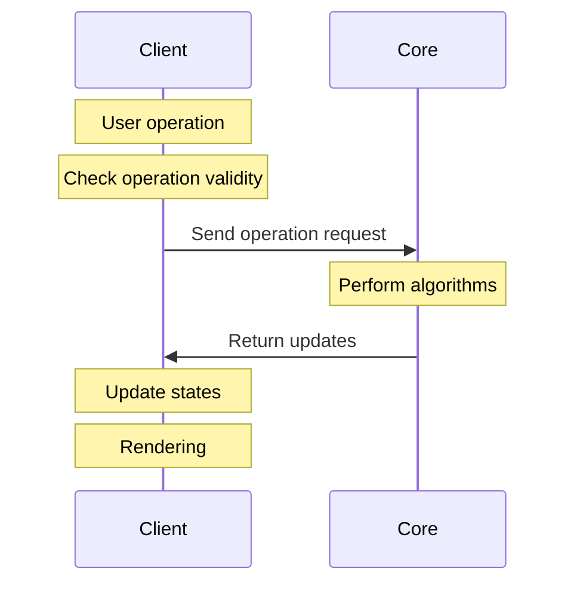

# Client

BP Studio Client is in charge of the workspace area.
It creates a [Core](../core/README.md) worker for each opened project,
handles user interactions and render the graphics using [Pixi.js](https://pixijs.com/).
It is built separately from the [App](../app/README.md) so that the App can be initialized faster.

The renderer prefers WebGPU and falls back to WebGL.
Notice that we skip the automatic extension imports of Pixi,
and instead import only the extensions that are actually used in this project,
so that the unused ones are tree-shaken.

The lifecycle between the Client and the Core is depicted as follows.

